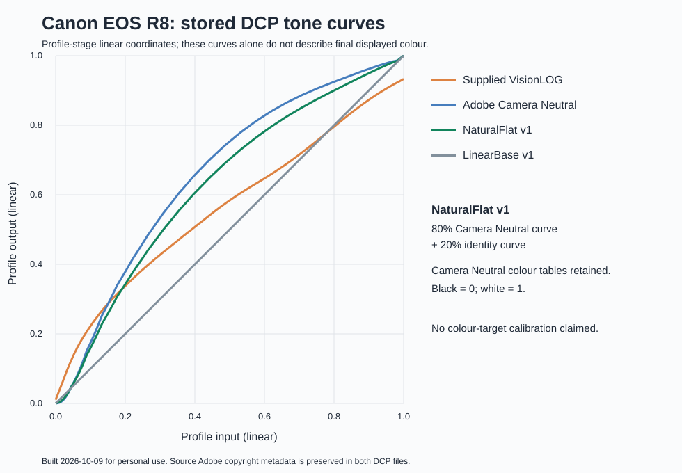

# 5D4 VisionLOG 到 R8 的配置数据近似移植

## 参考与目标

参考为 `VisionLOG_5DMkIV.dcp`，参考文件 SHA-256 记录在 `validation/5d4-match.json`。

目标是保留该参考的完整风格数据，为 R8 的传感器颜色建立一份近似对应的输入转换。没有一组匹配的两机实拍或色卡数据参与计算，因此模型内等价不代表实测色度等价。

## 相机矩阵适配

Adobe DNG 规范定义 ColorMatrix 将 XYZ 转换为相机原生颜色坐标；ForwardMatrix 配合白平衡对角矩阵，将相机坐标转换到 XYZ D50。HSM 位于该转换之后。

对 Standard A、D65 两个标定光源分别计算：

```text
CM8 = Adobe R8 的 ColorMatrix
CM5 = Adobe 5D4 的 ColorMatrix
W   = 对应光源的 XYZ 白点，Y = 1
n8  = CM8 × W
n5  = CM5 × W

T8_to_5 = diag(1/n5) × CM5 × inverse(CM8) × diag(n8)
FM8_new = FM5_VisionLOG × T8_to_5
```

这个 T 将 R8 经白平衡归一化的相机 RGB 近似映射到同光源下 5D4 的归一化相机 RGB。它使单位中性向量保持为单位中性向量，因此生成的 Forward Matrix 保留参考 Forward Matrix 的白点映射。

本次使用 Standard A 的 xy = (0.44757, 0.40745)，D65 的 xy = (0.3127, 0.3290)。Forward Matrix 以分母 100,000,000 的 SRATIONAL 保存。没有将 5D4 的 ColorMatrix 直接填到 R8 文件里。

在简化模型中，假设个体 CameraCalibration 和 AnalogBalance 为单位变换，则对每个标定光源和任意 XYZ 输入有：

```text
FM8_new × diag(1/n8) × CM8 × XYZ
≈ FM5_VisionLOG × diag(1/n5) × CM5 × XYZ
```

误差主要来自保存矩阵时的有限精度。每个端点用 10,000 个随机 XYZ 样本验证，序列化后的最大绝对 XYZ 差异低于 1e-7。这只验证模型构造及文件序列化，不是现实相机颜色准确度指标。

两个端点之间由 RAW 引擎插值；插值后的矩阵不一定严格等价于在每个色温重新求解完整模型。传感器同色异谱、真实照明光谱、个体机身校准和 RAW 引擎的其它步骤没有通过实拍拟合。

## 风格数据

以下标签与 5D4 VisionLOG 参考逐字节相同：

```text
50937 ProfileHueSatMapDims
50938 ProfileHueSatMapData1
50940 ProfileToneCurve
50941 ProfileEmbedPolicy
50981 ProfileLookTableDims
50982 ProfileLookTableData
51110 DefaultBlackRender
```

新增的 ProfileHueSatMapData2 与参考 Data1 相同，确保两个标定端点使用同一份原版表格。原版权元数据被保留，并补充相机校色数据来源。

参考原有的 ProfileToneCurve 端点不是规范中的标准 SDR 黑白端点；本次为了原版兼容保留了它，不能把“结构与数值校验通过”写成“全面通过 DNG 规范合规测试”。

## 可复核记录

`validation/5d4-match.json` 保存参考文件名及 SHA-256、源配置差异、生成矩阵、模型检查结果和验证状态。公开记录已移除本机绝对路径、安装位置及编辑中的照片信息。源文件未修改。

## 规范依据

Adobe DNG 1.7.1，ColorMatrix、ForwardMatrix 以及 Mapping Camera Color Space to CIE XYZ Space：

https://helpx.adobe.com/content/dam/help/en/camera-raw/digital-negative/jcr_content/root/content/flex/items/position/position-par/download_section_733958301/download-1/DNG_Spec_1_7_1_0.pdf

本算法是基于规范中矩阵定义构造的近似适配，并非 Adobe 或 VisionColor 发布的两机匹配方法。


## NaturalFlat 与 LinearBase

这两份配置以 Adobe 的 `Canon EOS R8 Camera Neutral.dcp` 为基础，仅修改 ProfileName（50936）和 ProfileToneCurve（50940）。色彩矩阵、Forward Matrix、Look Table、编码及其他颜色数据保持字节一致。

NaturalFlat 的 128 点曲线为 80% 原 Camera Neutral 曲线加 20% 恒等曲线；LinearBase 为两点恒等曲线。两者端点均为 (0,0) 与 (1,1)。LinearBase 的名称只指 DCP 曲线，不能据此推断最终导出图像的编码。



图中的坐标是配置阶段的线性域数值，不能直接当作屏幕 RGB 或传感器动态范围。

## 发布时的验收状态

结构与数值校验已完成。5D4 Match 两端点各 10,000 个随机 XYZ 样本的检查验证的是简化矩阵模型和序列化精度；101 个插值矩阵检查验证的是数值稳定性。没有同场景两机 RAW、色卡或多光源实拍校准。

本次公开发布没有新增 RAW 渲染验收。NaturalFlat 曾在 Camera Raw 当前配置选择中被观察到，但这不等于完成颜色验收；5D4 Match 与 LinearBase 的实际载入确认尚未完成。因此三份配置统一按预览版发布。
